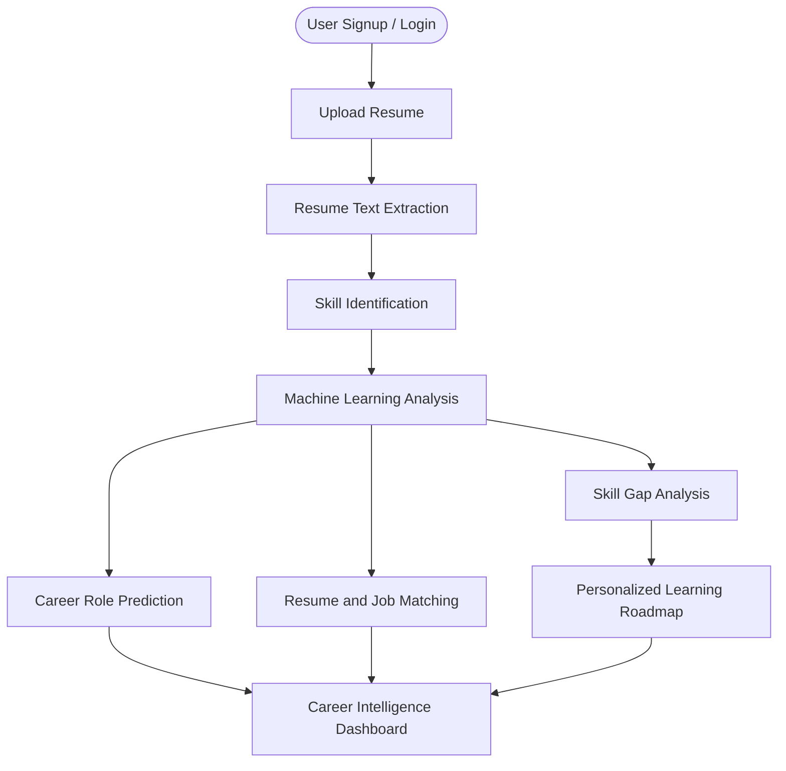

 
<div align="center">

# ✨ AVORA AI

### Your Career. Your Potential. Your Future.


**An AI-powered Career Intelligence & Growth Platform**

[](https://github.com/jenifer1104p/AVORA-AI)
[](https://react.dev/)
[](https://python.org/)
[](https://flask.palletsprojects.com/)

</div>

---

## 🚀 About AVORA AI

AVORA AI is an intelligent career development platform that combines **Machine Learning, Natural Language Processing and career analytics** to help users understand their skills, explore career opportunities and build structured learning plans.

It transforms resume information into actionable career insights through explainable ML techniques and structured recommendations.

## ✨ Key Features

| Feature | Description |
|---|---|
| 📄 Resume Intelligence | Upload PDF, DOCX or TXT resumes for analysis |
| 🎯 Career Match Explorer | Predict suitable career roles using ML |
| 🧠 Skill Extraction | Identify technical skills from resume content |
| 📊 Resume-to-Job Matching | Compare resumes with sample job requirements |
| 🔍 Skill Gap Analysis | Discover missing skills for a target role |
| 🗺️ Learning Roadmap | Generate a structured four-week learning plan |
| 👤 Career Profile | Explore career profile and clustering insights |
| 🔄 Career Simulator | Compare skill coverage across sample career roles |
| 🔐 User Authentication | Secure account access with JWT authentication |
| 📚 Analysis History | Access previous resume analysis results |

## 🛠️ Technology Stack

<div align="center">

### Frontend


### Backend


### Machine Learning & Database


</div>

## 🧠 Machine Learning Approach

AVORA AI uses multiple analytical techniques:

- **TF-IDF:** Converts resume and job descriptions into numerical text representations.
- **Cosine Similarity:** Measures textual similarity between resumes and sample job requirements.
- **Logistic Regression:** Classifies profiles into career-role categories.
- **K-Means Clustering:** Groups career profiles based on extracted features.
- **Rule-Based Analysis:** Supports skill-gap identification and learning roadmap generation.

## ⚙️ Application Workflow



## 📂 Project Structure

```text
AVORA-AI/
│
├── backend/
│   ├── ml_engine/
│   │   ├── artifacts/
│   │   ├── data/
│   │   ├── service.py
│   │   └── train.py
│   ├── app.py
│   ├── config.py
│   ├── models.py
│   ├── requirements.txt
│   └── run.py
│
├── frontend/
│   ├── public/
│   ├── src/
│   │   ├── assets/
│   │   ├── components/
│   │   ├── pages/
│   │   └── styles/
│   ├── package.json
│   └── vite.config.js
│
├── README.md
├── SETUP.md
└── .gitignore
```

## 🚀 Getting Started

### Prerequisites

- Python 3.10–3.12
- Node.js 20.19+ or 22.12+
- npm
- Git

### 1. Clone the Repository

```bash
git clone https://github.com/jenifer1104p/AVORA-AI.git
cd AVORA-AI
```

### 2. Configure the Backend

```bash
cd backend
python -m venv .venv
```

Activate the virtual environment:

**Windows:**

```powershell
.venv\Scripts\activate
```

Install dependencies:

```bash
pip install -r requirements.txt
```

Configure your environment variables using `.env.example` and follow the backend setup instructions.

Train the ML models:

```bash
python -m ml_engine.train
```

Start Flask:

```bash
python run.py
```

### 3. Configure the Frontend

Open another terminal:

```bash
cd frontend
npm install
npm run dev
```

### 4. Launch AVORA AI

Open the frontend in your browser:

```text
http://localhost:5173
```

Create an account and explore the career intelligence features.

For complete configuration details, see **[SETUP.md](SETUP.md)**.

## ⚠️ Project Scope & Limitations

- Job descriptions and role-training examples are sample or synthetic data, not live job vacancies.
- ML predictions are exploratory decision-support outputs, not validated hiring or employability scores.
- Skill extraction identifies text mentions; it does not verify actual proficiency or certificates.
- Career simulations compare skills against sample role requirements and do not predict future employment outcomes.
- Public deployment requires additional security hardening, including HTTPS, secure token storage, rate limiting, file scanning and database backups.

## 🔮 Future Enhancements

- Advanced resume feedback and optimization.
- Expanded career-role datasets.
- Interactive skill development tracking.
- Improved career recommendation models.
- Enhanced career analytics dashboard.

## 👩‍💻 Developer

**Jenifer P**

Software Developer | Java Full Stack | AI & Machine Learning Enthusiast

[](https://github.com/jenifer1104p)
[](https://www.linkedin.com/in/jenifer04p)

---

<div align="center">

### ✨ Explore. Learn. Evolve. ✨

**AVORA AI — Building Smarter Career Journeys.**

<sub>Designed and developed with curiosity, creativity and technology.</sub>

</div>
